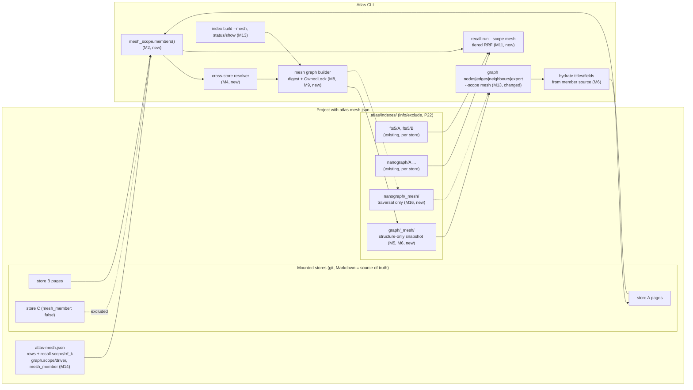
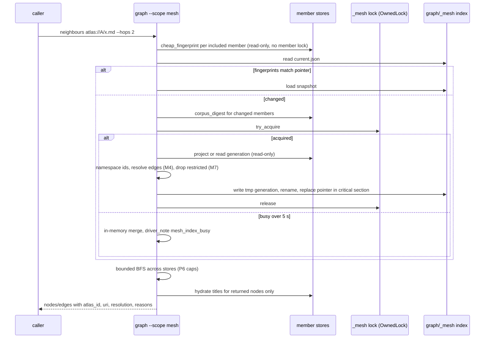

# Mesh-level indexing: one mesh graph and federated recall across mounted Atlases

Work ID: `2026-10-10-atlas-mesh-level-index`

Change-class: **new-surface**. It adds CLI flags and a config block (`--scope`, `recall.scope`, `graph.scope`, `mesh_member`), a new index location (`.atlas/indexes/<type>/_mesh/`), a cross-store link resolver and a fused result payload. It does not create a skill, so it is not `new-skill`. It is far more than a contract tweak, so it is not `hardening`.

Subject: Atlas. Baseline: `sergio-sisternes-epam/atlas` PR #61, branch `feat/graph-query-drivers`, head `57198e4` (not merged; 29 review threads resolved, CI green, Mac live check 9/9). Store: `github.com/sergio-sisternes-epam/atlas-atlas`, this page on a branch stacked on the PR #27 branch (head `244de59`).

Status: **implementing MA**. Atlas PR #61 merged as `7af5805` at 23:50 BST on 2026-10-10 (start condition M23). Packet MA is atlas PR #63 (`feat/mesh-core-ma`); see the [implement run record](../experiences/2026-10-11-implement-atlas-mesh-level-index-ma.md). Approved 2026-10-10 at 23:08 BST (see Approval below). Packets MA, MB, MC and MF are authorised; MD and ME wait for review of MB and MC. Nothing is implemented yet. Implementation runs through Copilot CLI, one packet per PR, and starts only after atlas PR #61 merges.

## Approval (2026-10-10, 23:08 BST)

Sergio approved this design at 23:08 BST on 2026-10-10, taking the recommended answer to every open question. The approval was relayed to this Run, not quoted verbatim.

| Pin | Decision |
|---|---|
| M20 | **Restricted pages (open question 1).** `sensitivity: restricted` pages are left out of the mesh graph and of federated results by default, as M7 says. There is **no override flag in v1**; `--include-restricted` is not built. Single-store recall is unchanged. |
| M21 | **Strict resolver (open question 2).** M4 stands as written: short-form `atlas://<name>/...` links are unresolved with `reason: noncanonical_atlas_uri` and a canonical `suggest`; no alias or repo-name matching. The 11 existing short-form links are fixed with **one small PR per store**: atlas-atlas (7, on the `docs/skill-help-pilot` line) and atlas-cartograph-atlas (4, `atlas-skill-memory`). Those store PRs are separate from the product packets and do not wait for them. |
| M22 | **Approved packet scope (open question 3).** Authorised now: **MA** (mesh core), **MB** (native mesh graph), **MC** (federated recall) and **MF** (benchmark kit). **MD** (nanograph mesh graph) and **ME** (config writers and docs) are approved in principle but start only after MB and MC have been reviewed. |
| M23 | **Start condition.** Implementation starts only after atlas PR #61 merges (M1), through Copilot CLI with a fresh session per packet (M19). Merging this store PR is not a start signal. |

The original design text below is kept as written. Where it conflicts with this section, this section wins.

## The request

Sergio asked on 2026-10-10 for mesh-level indexing. Today every Atlas gets its own index, and `recall run` and `atlas graph` take one `--root`, so there is no search or graph across Atlases. The shape agreed in discussion, and the "MESH GRAPH + federated RRF" advice already given to Grand Maester, is:

1. **Mesh graph.** One graph index per mesh (a project with `atlas-mesh.json`) covering every mounted store, so traversal can cross Atlas boundaries. Refreshed when any member changes. Native graph everywhere; nanograph where supported. Node ids namespaced by atlas id. Cross-Atlas edges resolve to real nodes or are reported unresolved.
2. **Federated search.** Keep per-store search indexes. Add a mesh-wide `recall run` that queries each member's own index and merges with Reciprocal Rank Fusion (k = 60 by default, configurable). Every hit carries its atlas id. Respect store privacy; never copy store content into a shared index.
3. **CLI.** A scope switch on `recall run` and `graph`, `atlas index build --mesh`, mesh reporting in `index status`/`show`, and a mesh-level preference in `atlas-mesh.json`. Single-store default unchanged.
4. **Evaluation.** A harder multi-Atlas answer benchmark with a fixed tool or token budget.

The broader recall token-economy plan (packets D/E: golden queries, gist-first payloads, stemming and aliases) has been on hold since 2026-10-09. This design keeps to mesh indexing; overlaps are listed as non-goals and follow-ups.

## Store resolution and recorded contradictions

- `atlas-mesh.json` in the atlas repo lists **two** stores (atlas-atlas and atlas-cartograph-atlas). Autogenesis treats that as ambiguous unless the id is explicit. This Run used the explicit id `github.com/sergio-sisternes-epam/atlas-atlas`: it is the store the Atlas skill's own card declares as its default, and the brief names it. That matches the 2026-10-09 Run.
- The mesh row pins `ref: docs/skill-help-pilot`. `atlas mount ... --ref main` (in a fresh clone of PR #61 at `/workspace/atlas-mesh-index-design`) rewrote the scratch mesh row to `main`, but left the superproject's gitlink commit `6c4ba92` checked out, which lives on `docs/skill-help-pilot`, not `main` (`e79aef0`). The atlas repo change was scratch only and is not committed.
- This page is written on a branch created from the PR #27 branch, because it `follows` the 2026-10-09 plan, which exists only there. Its PR targets the PR #27 branch, so it can be reviewed alone and retargets to `main` when #27 merges.

## Evidence

### How cross-store links are expressed today (read from PR #61 at `57198e4`)

| Fact | Source |
|---|---|
| The only cross-store link form is the `atlas://` URI. The settled lean: `atlas://<atlas-id>/<in-store-path>` (atlas id = `host/org/repo`), with `#fragment` meaning a heading, not a subpath. The in-store path is relative to the store's Atlas root (mount plus `subpath`) | `autogenesis/discuss/git-mesh/atlas-uri-vs-hash.md`, `decision-monorepo-subpath.md` |
| `identity.parse_pointer` peels `atlas://`, then reads host, org and repo; anything after is `in_store`, after `#` is `fragment` | `scripts/atlas_cli/core/identity.py` |
| Compile warns `atlas_uri_unmounted` (exit 0) when the parsed atlas id is not a mesh row | `commands/validate.py::_unknown_atlas_uri_warnings`; `decisions/unmounted-atlas-uri-non-blocking.md` |
| `atlas graph` (single store) keeps `atlas://` targets as edges with `resolved: false, external: true`; it never looks inside another store | `core/graph.py::all_edges` |
| Short aliases were dropped from identity in the MVP: "An alias hides where the knowledge lives" | `autogenesis/discuss/git-mesh/drop-aliases-mvp.md` |
| An id not in the local mesh is a known absence: no auto-mount on query | `autogenesis/discuss/git-mesh/decision-unresolved-id.md` |
| Relative `relates_to` paths are store-relative; compile treats a path that does not exist inside the store as broken | `commands/validate.py` (`relates_to broken path`) |

### What the real mesh contains (scratch probe, `/workspace/atlas-mesh-index-probe/`)

The probe mounted both rows of the atlas repo mesh and merged their projections with PR #61's own code. Scratch only; no product code.

| Measure | Value |
|---|---|
| Pages (atlas-atlas at the PR #27 branch / atlas-cartograph-atlas) | 474 / 28 |
| Edges in both stores | 2,195, of which 2,191 local and resolved |
| `relates_to` edges using `atlas://` | atlas-atlas `docs/skill-help-pilot` line: 7, all `atlas://atlas-cartograph-atlas/...`; cartograph: 4, all `atlas://atlas-skill-memory/...` |
| Of those 11, how many parse to a mesh member under the canonical grammar | **0**. `parse_pointer` reads `atlas-cartograph-atlas` as a host, `help` as the org and the file name as the repo; compile already prints them as unmounted ids |
| How many would match a member by repo name alone | 7 (`atlas-cartograph-atlas`); the 4 use `atlas-skill-memory`, a former name that matches nothing |
| Load and project, per store | 148 ms / 10 ms (no published generation) |
| `cheap_fingerprint`, per store | 32 ms / 2 ms |
| Merge, namespace and resolve all edges in memory | 5 ms |
| Structure-only snapshot (ids, type) | 58 KB for 502 nodes |
| Federated `recall run --engine bm25` over both stores, plain RRF k = 60, five queries | 0.4–0.7 s wall with one CLI subprocess per member |

Two findings shape the design. First, **cross-store links exist but none resolve today**; the resolver must say why each one fails and suggest the canonical form, otherwise the mesh graph has nothing to cross. Second, **plain RRF over per-store lists is a rank interleave**: page ids are disjoint between stores, so no page ever appears in two lists. On "graph export nanograph", atlas-atlas found 3 all-words hits while cartograph fell back to its any-word retry and returned 10. Plain RRF placed cartograph's any-word hits at ranks 2, 4 and 6, level with atlas-atlas's precise ones.

## Recommendation

Build both halves, but keep them separately mergeable and separately judged.

- A **structure-only mesh graph**: ids, types, lifecycle scalars and resolved edges, no words. Text for display is read back from each member at query time. That gives cross-Atlas traversal without a shared copy of anyone's content.
- **Federated recall** with no shared index: each member answers from its own index, and the CLI fuses the lists with **tiered** RRF (all-words lists before any-word retries, then RRF), over-fetching twice the limit from each member.
- A **strict resolver** that follows the settled no-alias decision, plus a small store fix for the 11 existing links.
- A **pre-registered benchmark** that decides whether mesh scope is promoted beyond opt-in.

Land it as **follow-up PRs on top of `main` after PR #61 merges**, not on `feat/graph-query-drivers`. PR #61 is reviewed, green and Mac-checked; adding about 2,000 lines to it would reopen review, and every packet here needs PR #61's index location, owner-token lock and driver overlay as a stable base.

## Pinned decisions

Numbering continues from the 2026-10-09 plan's P1–P27 with an `M` prefix.

| # | Decision |
|---|---|
| M1 | **Landing.** Six packets (below), each its own PR into `sergio-sisternes-epam/atlas` `main`, opened only after PR #61 merges. No commits are added to `feat/graph-query-drivers`. If PR #61 is still open when packet MA is ready, MA may be stacked on it as a draft PR and rebased after the merge, but it is not merged first. |
| M2 | **Mesh and members.** The mesh is the project whose `atlas-mesh.json` lists the `--root` store (found with PR #61's `index_location.mesh_match`), or the project directory itself when `--root` points at it. Members are its rows in file order whose root (`path` plus `subpath`) is mounted and holds a contract file. A row with `mesh_member: false` is excluded. Unmounted rows are reported with `status: unmounted` and are never auto-mounted. `--scope mesh` on a standalone store (no mesh row matches) exits 2 with "no atlas-mesh.json lists this store". |
| M3 | **Node identity.** A mesh node id is the canonical URI `atlas://<atlas-id>/<store-relative path>`, the same grammar compile and `parse_pointer` already use, so a canonical cross-store `relates_to` target is the target node id. Every mesh node and hit also carries `atlas_id` and `path`. Single-store payloads gain no fields. |
| M4 | **Cross-store link resolution**, in this order, applied to every `relates_to` target in mesh scope: (a) a store-relative path to a page in the same store is a local edge (unchanged); (b) a canonical `atlas://<atlas-id>/<path>[#fragment]` is parsed with `parse_pointer`, the fragment is dropped, and the edge resolves (`resolution: atlas_uri`) when the id is an included member and the path is one of its projected pages; (c) a **mesh-relative path**, meaning a relative target that leaves its own store root, or a project-relative `.atlas/<host>/<org>/<repo>/...` path, resolves (`resolution: mesh_path`) only when it lands on a page inside another member's root without crossing a symlink. It carries a `noncanonical_cross_store_link` warning and a `suggest` canonical URI, because it breaks in any project that mounts the stores elsewhere; (d) anything else is an unresolved edge with one `reason`: `unmounted` (id not in the mesh), `excluded_member` (row has `mesh_member: false`), `missing_page`, `withheld` (target page is `sensitivity: restricted`), `outside_mesh` (path escapes every member) or `noncanonical_atlas_uri`. The last one covers a short form `atlas://<name>/<path>` whose first segment is not a host (no dot). That form is **not** resolved as an alias, which follows the settled no-alias decision; `suggest` names the canonical URI when exactly one member's repo name equals `<name>` (open question 2). Unresolved edges are always returned and counted, never dropped. |
| M5 | **Mesh index location.** `<project>/.atlas/indexes/<type>/_mesh/`, beside the per-store `<type>/<atlas-id>/` directories. `_mesh` cannot collide with any store: PR #61's id segment rule `[A-Za-z0-9][A-Za-z0-9._-]*` rejects a leading underscore. One new helper, `index_location.mesh_index_dir(project, type)`, applies the same symlink and escape guards as `index_dir`. Native mesh graph: new driver type `graph`, used only for `_mesh`; generation layout as fts5 (`generations/<gen>/mesh-graph.json` plus `current.json`). The single-store graph stays index-free (P4 unchanged). nanograph mesh graph: `nanograph/_mesh/<generation>/`, built as in P18. FTS5 has **no** `_mesh` directory. |
| M6 | **Mesh index contents, structure only.** Node id, `atlas_id`, `path`, `type` and the lifecycle scalars `kva`, `status`, `work_id`, `sensitivity`, `growth`, `consolidation`, `star_kind`, `kva_role` and `origin`. Edges carry `from`, `to`, `kind`, `resolution` and, when unresolved, `reason` and `suggest`. **No title, description, body, tags or any other frontmatter text.** Titles and `--where` on other fields are read at query time from that member's own source (its published fts5 generation when the fingerprint matches, else its projection), and only for nodes being returned. |
| M7 | **Privacy.** (1) A `mesh_member: false` store is not read at all in mesh scope: no projection, no search, no nodes. (2) Pages with `sensitivity: restricted` are left out of the mesh graph and filtered out of federated results **before** ranking: the eligible set is passed into each member's search, so counts and ranks never reveal them (open question 1). An edge to one reports `withheld`, which only tells the author of that link that the path they wrote exists. (3) Each member's own recall profile and exclusions still apply, because members run their own pipeline (P26). (4) Federated search creates no shared text index; each member reads only its own index at its own path. (5) `graph export --scope mesh` writes structure only, refuses an `--out` inside any member root or under `.atlas/indexes/`, and lists the member ids it combined. (6) Mesh indexes live under `.atlas/indexes/`, which PR #61 already adds to `info/exclude` (P22). |
| M8 | **Digest and freshness.** `mesh_digest` = sha256 of canonical JSON holding the index format, resolver version, privacy policy version, and for each included member (sorted by id) its id, mesh `path`, `subpath` and `corpus_digest`, plus the sorted excluded ids. The pointer also records each member's `cheap_fingerprint`. On a mesh read, compute every included member's fingerprint (2–32 ms each in the probe). If all match, the index is fresh. Otherwise recompute the changed members' corpus digests, and if `mesh_digest` changed, rebuild before answering, as in P24. A membership or config change changes the digest. A nanograph mesh index also keys on the binary version. |
| M9 | **Refresh and locking.** Reuse PR #61's `owned_lock.OwnedLock` through `index_publish.BuildLock` and `locked_build` on the `_mesh` parent directory: build in a temporary sibling, rename into place, replace the pointer inside `owned_critical_section`, keep the pointer's generation plus one, 10-minute stale timeout. A reader that finds the lock held waits up to 5 s, then answers from an in-memory merge with `driver_note: mesh_index_busy`. **Lock order:** the mesh lock is never held while a member lock is taken. The mesh build reads member pages and generations read-only and takes no member lock. A member whose own preferred index is stale is not rebuilt by a mesh read. |
| M10 | **Refresh triggers.** No daemon and no watcher. (a) Any `--scope mesh` graph read; (b) `atlas index build --mesh [--force]`; (c) `atlas compile` (not `--dry-run`) on a member store refreshes the mesh graph **only if a mesh index already exists** for that project. A failed refresh is a warning and never changes compile's exit code. |
| M11 | **Federated recall.** `recall run --scope mesh` runs, for each included member in mesh row order, that member's effective engine (P23 precedence unchanged; an explicit `--engine` applies to every member), in process, asking for `2 × limit` hits. Fusion: **tier first**, where hits from a list the member produced with all-words matching, or by grep or nanograph, are tier 1 and hits from an any-word retry (`match: any`) are tier 2. Then RRF score `Σ 1/(k + rank)` with 1-based member rank, then mesh row order, then path. The result is truncated to `limit`. k defaults to 60 and is set by `--rrf-k N` (1–1000) or top-level `recall.rrf_k`. Because page ids are disjoint across stores, v1 RRF ranks like an interleave within each tier. The formula is kept so that later per-member lists (title match, graph proximity: the Master of New RRF research) can join without a contract change. |
| M12 | **Federated payload and exit codes.** `scope: mesh`, `rrf_k`, `complete`; `hits[]` with `atlas_id`, `path`, `uri`, `title`, `member_rank`, `tier`, `rrf_score` and `engine_used`; `members[]` with `atlas_id`, `status` (`ok`, `excluded`, `unmounted` or `error`), `engine_requested`, `engine_used`, `driver_note`, `match` and `hits`. Exit 0 when every included member answered; exit 1 when at least one included member failed but others answered (`complete: false`); exit 2 for invalid input: `--profile` with `--scope mesh` (profiles are per store), no mesh found, or k out of range. |
| M13 | **CLI.** `--scope store\|mesh` on `recall run` and on `graph nodes\|edges\|neighbours\|export`. No separate `--mesh` alias on these, so there is one switch. In mesh scope a page argument is a canonical `atlas://` URI or a path in the `--root` store; `nodes` and `edges` add `--store <atlas-id>` (repeatable). `neighbours --driver native\|nanograph` works as today. `atlas index build --mesh [--force]` (combinable with `--all`). `index status` gains a `mesh` block: members and their status, excluded ids, effective scopes with their source, and per driver the index path, generation, freshness and unresolved counts by reason. `index show --mesh` prints that block alone. Config writers: `atlas index scope <store\|mesh> [--recall\|--graph]` and `atlas index member <atlas-id> --exclude\|--include`, written atomically through `meshfile` with P27's rules. |
| M14 | **Config and precedence.** `atlas-mesh.json` schema additions: top-level `recall.scope` (`store`/`mesh`) and `recall.rrf_k` (integer 1–1000); a new top-level `graph` object with `scope` (`store`/`mesh`) and `driver` (`native`/`nanograph`); a row-level `mesh_member` boolean (default true). Scope is a mesh-level choice, so `scope` on a row's `recall` block is a validation error naming the row. Precedence: flag > top-level config > built-in `store`. No environment variable in v1; benchmarks pass the flag. |
| M15 | **Single-store default unchanged.** With no flag and no new config key, every command's output is byte-identical to PR #61 on the same fixtures. This is an acceptance test, not just a goal. |
| M16 | **nanograph at mesh level** is traversal only (capability `graph_traversal`), never BM25. It is built from a structure-only mesh export when `graph.driver: nanograph` or `--driver nanograph` asks for it, and only on macOS arm64 with a detected binary (P16). Otherwise it falls back to native with a `driver_note`, exit code unchanged. |
| M17 | **Benchmark decides promotion.** The multi-Atlas benchmark's criteria are fixed before it runs (Evaluation plan). If they fail, mesh scope stays opt-in, the skill docs do not recommend `scope: mesh`, and the result is recorded as a lesson. |
| M18 | **Scope boundary with D/E.** No change to ranking inside a store, tokenisation, stemming, aliases, golden queries or gist-first payloads. Those stay on hold and are listed as follow-ups. |
| M19 | **Implementation** runs through Copilot CLI only, a fresh session per packet, never `--continue`, as in P14. Packet prompts are written after approval. |

## Genesis Artifacts

### Intent and scope

Let an agent ask one question across every Atlas a project mounts. "What do my Atlases say about X?" returns hits from each store, fused and labelled by atlas id. "What links to this page, from any store?" or "what lies within two hops?" follows `relates_to` across store boundaries. Both work without copying any store's text into a shared index, and single-store behaviour is unchanged.

Trigger: an agent, skill or benchmark harness working in a project with `atlas-mesh.json` needs pages or structure from more than one Atlas, by passing `--scope mesh` or setting `recall.scope`/`graph.scope`.

Dispatch description sketch (Atlas SKILL.md CLI surface; no new path module, because these are flags on existing tools used inside paths `recall`, `work` and `remember`):

> `--scope mesh` on `atlas recall run` and `atlas graph ...`: search or traverse every Atlas mounted in this project's atlas-mesh.json. Hits and nodes carry their atlas id; cross-Atlas `atlas://` links are followed when they resolve and reported when they do not. Default scope is the single store at `--root`.

### Non-goals

- A shared full-text index across stores (FTS5 `_mesh`), or global IDF across stores.
- Changing ranking inside a store, tokenisation, stemming, aliases, golden queries or gist-first payloads (D/E, on hold).
- Resolving short or historical aliases (`atlas://atlas-skill-memory/...`), or auto-mounting an unmounted id.
- Embeddings, semantic search, or graph-proximity re-ranking of recall.
- A graph query language, or hops beyond 3 (P3, P6 unchanged).
- Search or traversal across projects (meshes); one mesh per project.
- Editing store pages. Fixing the 11 existing short-form links is a separate store change (open question 2).
- Releasing or tagging; that belongs to Master of Packages.

### Component diagram



### Sequence: mesh graph read with refresh and locking



### Interface sketch

```text
atlas recall run "<q>" --root <store-or-project> --scope mesh [--engine E] [--rrf-k 60] [--limit N] [--json]
  -> {scope:"mesh", rrf_k, complete,
      hits:[{atlas_id, path, uri, title, member_rank, tier, rrf_score, engine_used}],
      members:[{atlas_id, status, engine_requested, engine_used, driver_note, match, hits}]}

atlas graph nodes --scope mesh [--store <id>]... [--where f=v]... [--path <prefix>] [--json]
  -> {scope:"mesh", mesh_digest, nodes:[{id:"atlas://<id>/<path>", atlas_id, path, type, title, ...}]}

atlas graph edges --scope mesh (--from <uri|path> | --to <uri|path> | --all) [--store <id>]... [--kind K]...
  -> {edges:[{from, to, kind, cross, resolved, resolution:local|atlas_uri|mesh_path,
              reason?:unmounted|excluded_member|missing_page|withheld|outside_mesh|noncanonical_atlas_uri,
              suggest?}], unresolved_by_reason:{...}}

atlas graph neighbours <uri|path> --scope mesh [--direction in|out|both] [--hops 1..3]
                       [--driver native|nanograph] [--max-nodes N] [--json]
  -> {seed, nodes:[{id, atlas_id, path, hop, ...}], edges:[{..., cross}], truncated, driver_used}

atlas graph export --scope mesh --format json|nanograph --out <dir outside members and .atlas/indexes>
  -> structure-only graph.json | schema.pg + seed.jsonl + export-receipt.json (members, unresolved)

atlas index build --mesh [--all] [--force] [--json]
atlas index status [--json]            -> {..., mesh:{members, excluded, scope:{recall, graph, source},
                                            indexes:{graph:{dir, generation, fresh, unresolved_by_reason},
                                                     nanograph:{...}}}}
atlas index show --mesh [--json]
atlas index scope <store|mesh> [--recall|--graph]
atlas index member <atlas-id> --exclude|--include

atlas-mesh.json additions:
  {"recall": {"engine": "...", "scope": "store|mesh", "rrf_k": 60},
   "graph":  {"scope": "store|mesh", "driver": "native|nanograph"},
   "stores": [{"id": "...", "path": "...", "mesh_member": false}]}

Exit codes: 0 ok; 1 partial (a member failed, or --allow-partial projection); 2 invalid input.
```

### Cost note

- Runtime, mesh graph: one `cheap_fingerprint` per member per read (2–32 ms each in the probe), then a snapshot load (58 KB for 502 nodes). A rebuild costs about the sum of the member projections (about 160 ms for the probe's two stores) plus about 5 ms to merge.
- Runtime, federated recall: one in-process search per member. The probe used one CLI subprocess per member (0.4–0.7 s for two members); in-process should be lower but is not measured yet. Packet MF measures it at 2, 5 and 10 members.
- Tokens: each hit gains `atlas_id` and `uri`, roughly 15 tokens per hit. The `members[]` block is a few lines per member. Agents can drop per-store calls, which is what the benchmark measures.
- Maintenance: one resolver, one builder, one fusion function, and schema keys. No new dependency; `scripts/requirements.txt` unchanged.
- Implementation: six Copilot CLI packets, about 2,050 lines of code plus 1,750 lines of tests in total (see Implementation packets).

### Acceptance

1. With no flag and no new config, every existing command produces byte-identical output to PR #61 on the repo fixtures, and the existing suite stays green (M15).
2. On a three-store mesh fixture, `graph neighbours --scope mesh` crosses a canonical `atlas://` edge into another store, and every non-resolving link is returned with the expected `reason` (M4).
3. No file under `.atlas/indexes/*/_mesh/` contains a canary word placed in a member's titles, descriptions or bodies, or any text from a restricted page or an excluded store (M6, M7).
4. Federated results never include a restricted page or an excluded store, and `members[].hits` counts are computed after the restricted filter (M7).
5. Fusion is deterministic: two runs give byte-identical JSON; tier 1 hits precede tier 2; ties break on row order, then path (M11).
6. A changed member page changes `mesh_digest` and triggers exactly one rebuild under concurrent readers. Two concurrent builders never both publish, and a lock takeover publishes nothing (M8, M9).
7. `--scope mesh` on a standalone store, `--profile` with mesh scope, a row-level `recall.scope`, and an out-of-range k all exit 2 with a message naming the cause (M2, M12, M14).
8. On Linux CI, `--driver nanograph` at mesh scope falls back to native with a `driver_note`; fake-binary tests cover the nanograph build; the Mac live test is skipped with a reason (M16).
9. `index status --json` reports the mesh block with members, excluded ids, scope sources, index freshness and unresolved counts (M13).

### Stop for approval

This design stops here. Implementation needs Sergio's explicit approval of this persisted plan, naming which packets, and is not authorised by merging the store PR.

## SOLID lens

| Principle | Status | Rationale / design consequence |
|---|---|---|
| S | applicable | Three reasons to change, three units: `mesh_scope` (who is in the mesh and how links resolve), the mesh graph builder (structure snapshot, freshness, locking) and federated fusion (rank merge). Search stays inside each member; the mesh layer never ranks text itself. Config writers stay in `atlas index`, which already owns `atlas-mesh.json` writes. |
| O | applicable | Closed: single-store semantics, P23 engine precedence, P26 profile rule, exit-state rule, the single-store graph's index-free design. Open through declared points only: driver types under `.atlas/indexes/<type>/_mesh/`, and a list-of-ranked-lists fusion input so later retrievers can join RRF without a payload change. No plug-in system is added. |
| L | trade-off | Interchangeability is claimed for the mesh graph drivers: native and nanograph must give identical `neighbours` answers on the mesh fixture, as P15–P17 require per store. It is **not** claimed between scopes: a mesh hit list is not a superset of a store hit list in the same order, because tiers and RRF reorder it. The payload says `scope` so callers can tell. |
| I | applicable | One `--scope` switch rather than separate mesh commands; mesh-only options (`--rrf-k`, `--store`) are inert in store scope and rejected there with exit 2, rather than silently ignored. `index status` grows one block instead of a new command. Callers who never use a mesh see no new required input. |
| D | applicable | Fusion depends on the member search contract (ranked hits plus `match`), not on SQLite or nanograph. The builder depends on the projection and PR #61's `owned_lock`, not a new lock. The concrete pressure for the `graph` driver type is a real second implementation (nanograph) at mesh level; no other abstraction is added. |

## Catalogue Review

- Scope: in scope, narrowly, because M5 and M16 extend PR #61's driver and index contract to a mesh level.
- Genesis matches: none for agent topology. This is a CLI and tool surface; no panel or fan-out. The federated search is a library-level fan-out over local indexes, not an agent fan-out, so A1 PANEL and B1 FAN-OUT do not apply.
- Autogenesis extensions: B17 ACTIVATION CARD unchanged (mesh flags run under the caller's recall or work card). `autogenesis:S8`: not selected; no private skill module is added.
- Composition mode: INLINE for every packet (inside the Atlas CLI). EXTERNAL for nanograph, which is already admitted behind the driver overlay.
- Inherited anti-patterns avoided: second store of record (structure-only index, text read back from members); automatic mounting (decision-unresolved-id); aliases that hide where knowledge lives (drop-aliases-mvp); daemon ownership.
- pattern_applicability: not-applicable (no new pattern). pattern_admission: not-selected.

## Behavioural contract (agent-spec)

Deferred: agent-spec is still not in this harness's skill catalogue (`/home/box/agent-data/workflows` has no agent-spec package), so `specify` cannot run. Implement must run `specify` before packet MC merges, or record a new deferral. Protecting scenarios to name there: `@critical` "with no flag and no config, single-store output is unchanged"; `@forbidden` "text from a restricted page or an excluded store appears in any `_mesh` index file or federated hit"; `@forbidden` "a mesh read takes a member lock while holding the mesh lock"; `@critical` "an unresolved cross-store link is returned with a reason, never dropped".

## Evaluation plan

### Deterministic smokes (primary, repo and CI)

| Check | Command or test |
|---|---|
| Single-store unchanged | New `scripts/test_mesh_scope_default.py`: run every `recall run`, `graph *` and `index *` fixture case with and without `--scope store`, and against PR #61 golden output; byte-identical |
| Resolver reasons | `scripts/test_mesh_resolver.py`: fixture mesh with canonical URI, URI plus `#heading`, mesh-relative `../`, `.atlas/...` path, short form with a unique repo-name match, stale alias, unmounted id, excluded member, missing page, restricted target, symlink escape; assert `resolution`, `reason` and `suggest` for each |
| Cross-store traversal | `scripts/test_mesh_graph.py`: `neighbours atlas://A/x.md --direction in --kind implements --hops 2` finds a child in store B; `--driver nanograph` falls back on Linux with `driver_note` |
| Canary privacy | Seed a unique canary word into one title, one description and one body in each store, and into every field of a restricted page and of an excluded store; build the mesh index and run five federated queries; `rg -c <canary>` over `.atlas/indexes/*/_mesh/` is 0; no federated hit has a restricted path or an excluded atlas id; `members[].hits` excludes them |
| Fusion maths | `scripts/test_mesh_rrf.py`: hand-computed RRF for k = 1, 60 and 1000; tier ordering; over-fetch of `2 × limit`; deterministic ties; exit 1 with `complete: false` when one member's schema is broken |
| Freshness and locking | Extend `scripts/test_index_lock_ownership.py` patterns: touch a member page, assert the digest changes and one rebuild happens; two concurrent builders publish once; the takeover hook publishes nothing; a reader blocked over 5 s answers in memory with `mesh_index_busy`; a monkeypatched member lock asserts it is never taken during a mesh build |
| Config validation | `scripts/test_mesh_config.py`: new keys accepted; row `recall.scope` rejected; k out of range rejected; `atlas index scope` and `atlas index member` keep key order, indentation and trailing newline, and do not write when unchanged |
| Status reporting | `index status --json` mesh block keys and values on the fixture |
| No dependency | `scripts/requirements.txt` unchanged; `python3 scripts/run_tests.py` green |
| Store compile | `atlas compile --root <store>` exit 0 on atlas-atlas after the change |

### Retrieval quality (box, deterministic, packet MF)

- A labelled set of at least 30 queries over a scratch mesh of atlas-atlas, atlas-cartograph-atlas and one more mounted store. Each query is labelled with the relevant pages, and at least half need pages from two stores.
- Arms: best single store (oracle choice), plain RRF, tiered RRF (k = 10, 60, 100), raw-BM25-score merge, and a scratch-only single FTS5 index over all stores. The last one is a measuring stick for counter C2 and is never shipped.
- Metrics: Recall@10 and MRR, per-member latency at 2, 5 and 10 members (members duplicated for the latency run only), and unresolved-link counts by reason on the real mesh.

### Multi-Atlas answer benchmark (Sergio's Mac, harness `~/scratch/atlas-answer-bench`)

Baseline from the earlier 225-run benchmark on Warden of the North's 333-page Atlas: tools barely changed quality (91–94 % facts), Atlas setups cut credits by 15–20 %, and the graph was rarely used (13/45 and 7/45 runs). The new benchmark is meant to be harder and to give the mesh a fair test.

- **Corpus.** Warden of the North's Atlas plus at least two other mounted Atlases in one mesh, with canonical `atlas://` cross-links fixed first (open question 2), so the graph has edges to cross.
- **Questions.** 30 questions, each needing facts from pages in at least two Atlases (20 need two, 10 need three), plus 10 single-Atlas control questions. Each has a fact checklist and the expected source atlas ids, written before any run.
- **Budget.** Fixed per run: at most 6 Atlas tool calls and 60k input tokens. A run that hits the budget is scored on what it answered.
- **Arms.** A0 no Atlas tools; A1 per-store tools as shipped in PR #61 (the agent must pick `--root`); A2 A1 plus `recall run --scope mesh`; A3 A2 plus `graph --scope mesh`.
- **Runs.** 4 arms × 40 questions × 2 seeds = 320 runs, same model and harness settings as the 225-run benchmark.
- **Metrics.** Fact accuracy, source-id correctness, credits and tokens per run, budget-exhaustion rate, tool calls by kind, graph-use rate.
- **Pre-registered success criteria (M17).** Mesh scope is promoted beyond opt-in only if, on the multi-Atlas questions, A2 or A3 beats A1 by at least 5 points of fact accuracy at equal budget, **or** matches A1 within 1 point with at least 15 % fewer credits, **and** the single-Atlas controls do not drop by more than 2 points. A3 counts as better than A2 only if it beats A2 by at least 3 points or the graph is used in at least a third of A3 runs. Anything else is a "keep opt-in" result and is recorded as a lesson.

Agent evaluations (secondary): a recall-path trajectory check that an agent asked a two-Atlas question uses one `--scope mesh` call rather than one call per store. Never the only evidence.

## Adversarial scenario draft

Target file: `references/scenarios/mesh-index-adversarial-v1.yaml` in the atlas repo.

```yaml
id: mesh-index-adversarial-v1
packages: [atlas]
work_id: 2026-10-10-atlas-mesh-level-index
adversarial: true
expect:
  single_store_unchanged: true
  mesh_index_structure_only: true
  unresolved_links_visible: true
smokes:
  - id: rrf-interleave-noise
    source: "Probe 2026-10-10: plain RRF placed cartograph any-word hits at ranks 2, 4, 6 for 'graph export nanograph'; jammi-ai rrf.rs disjoint-list tie test"
    expect: "A member's any-word retry hits never outrank another member's all-words hits."
  - id: no-shared-text-index
    source: "CWE-612 Improper Authorization of Index Containing Sensitive Information; Elastic: cross-index scoring needs one index"
    expect: "No file under .atlas/indexes/*/_mesh/ contains a canary from any title, description or body."
  - id: restricted-prefilter
    source: "eworks.cloud: post-filtering leaks counts; NIST SP 800-53 AC-21(2) via Daydream"
    expect: "Restricted pages are absent from federated hits and from members[].hits counts."
  - id: excluded-member-unread
    source: "Brief 2026-10-10: honour per-store exclusion"
    expect: "With mesh_member false, no file of that store is opened in mesh scope (open() monkeypatch)."
  - id: no-alias-resolution
    source: "drop-aliases-mvp: an alias hides where the knowledge lives; probe: 11 short-form links, 0 canonical"
    expect: "atlas://atlas-cartograph-atlas/x.md is unresolved with reason noncanonical_atlas_uri and a canonical suggest."
  - id: no-auto-mount
    source: "decision-unresolved-id: no implicit mount on query"
    expect: "An unmounted id yields reason unmounted; git and network are never called."
  - id: unresolved-visible
    source: "P6: unresolved targets are returned, never silently dropped"
    expect: "Every relates_to edge in the mesh appears once, resolved or with a reason."
  - id: lock-order
    source: "Coffman conditions (circular wait); P24 lock"
    expect: "A mesh build never acquires a member BuildLock while holding the mesh lock."
  - id: single-store-hyrum
    source: "Hyrum's law: callers depend on current payloads"
    expect: "Without --scope or config, output is byte-identical to PR #61 goldens."
  - id: benchmark-goodhart
    source: "Goodhart's law; BCAS (arXiv 2603.08877) gains plateau near three searches"
    expect: "Promotion criteria are committed before the benchmark runs and use a fixed tool and token budget."
  - id: id-collision
    source: "PR #61 id segment rule rejects a leading underscore"
    expect: "No mounted store id can map to .atlas/indexes/<type>/_mesh/."
```

## Implementation packets

All packets: Copilot CLI only, fresh session, never `--continue` (M19). Each is one PR into `sergio-sisternes-epam/atlas` `main`, with tests, opened after PR #61 merges (M1). Sizes are estimates for the code plus the tests in that packet.

| Packet | Content | Depends on | Size |
|---|---|---|---|
| MA. Mesh core | M2–M4, M14 schema keys and validation, `index_location.mesh_index_dir` with the `_mesh` guard (M5). New `core/mesh_scope.py` (members, ids, resolver). No user-visible command yet apart from config validation | PR #61 merged | S–M: about 350 code + 350 test lines, 1 session |
| MB. Native mesh graph | M5–M10 for `graph/_mesh/`: builder, digest, `OwnedLock`, refresh, compile hook; `--scope mesh` on `graph nodes\|edges\|neighbours\|export --format json`; `index build --mesh`; `index status/show` mesh block; hydration | MA | M–L: about 650 code + 550 test lines, 1–2 sessions |
| MC. Federated recall | M7, M11, M12: `recall run --scope mesh`, tiered RRF, `--rrf-k`, restricted pre-filter into member search, payload, exit codes | MA (parallel with MB) | M: about 450 code + 450 test lines, 1 session |
| MD. nanograph mesh graph | M16: structure-only mesh nanograph export, `nanograph/_mesh/` build and traversal, fallback; fake-binary tests; Mac live check (like PR #61's 9/9) | MB | S–M: about 250 code + 250 test lines, 1 session |
| ME. Config writers and docs | `atlas index scope`, `atlas index member` (M13); SKILL.md CLI lines; `references/paths/recall.md`, `references/graph.md`, mesh docs; CHANGELOG; the adversarial scenario file | MB, MC | S: about 200 code + 150 test lines plus docs, 1 session |
| MF. Benchmark kit | `fixtures/mesh/` three-store fixture; contributor-only labelled query set and Recall@k/MRR script under `contributor/` (not shipped in the skill bundle); latency runs; Mac harness spec handed to the bench | MA (query set), MC (scoring) | S: about 150 code lines plus data, 1 session; the Mac runs are separate |

Total: about 2,050 code and 1,750 test lines across six PRs. MA, MB and MC together carry the requested capability. MD, ME and MF can follow as each is ready.

## Consequences outside the atlas repo

- **Stores.** The 11 short-form links (7 in atlas-atlas on `docs/skill-help-pilot`, 4 in atlas-cartograph-atlas) need canonical targets (`atlas://` plus the full `github.com/sergio-sisternes-epam/...` id and the page path) before the mesh graph can cross them. That is a separate store PR each (open question 2).
- **Master of New.** Its RRF research task ("Explore hybrid retrieval with Reciprocal Rank Fusion for Atlas recall") is the natural home for multi-retriever fusion inside one store. M11 keeps the fusion input open for it; nothing here pre-empts that research.
- **Grand Maester.** No new system tools. nanograph on the Mac is unchanged from PR #61.
- **Master of Packages.** Release of the packets as one minor version once MA–MC have merged.
- **Benchmark (Sergio's Mac).** The harness at `~/scratch/atlas-answer-bench` needs the new corpus, question set and arms. Only Sergio's Mac can run it.

## Follow-ups (parked, not authorised)

- D/E: golden queries, gist-first payloads, stemming and aliases (on hold since 2026-10-09). Golden queries would reuse MF's labelled set.
- Multi-retriever RRF inside one store (title match, graph proximity), per the Master of New research.
- Per-member weights in fusion, only if the benchmark shows one store systematically drowning others.
- A compile check that warns on short-form `atlas://` with a canonical suggestion, sharing M4's resolver.

## Challenge and dispositions

Search-grounded counters (think-challenge), with dispositions:

| # | Counter | Source | Severity | Disposition |
|---|---|---|---|---|
| C1 | RRF's evidence comes from fusing several systems ranking the **same** documents; with disjoint lists there is no agreement to reward, so it reduces to per-list rank and a weak store's first hit equals a strong store's first hit | Cormack, Clarke and Büttcher, SIGIR 2009; jammi-ai `rrf.rs` disjoint-list test; llm-kernel `federation.rs` over-fetch note; this Run's probe ("graph export nanograph") | High | **Modified.** Keep RRF as the contract (Sergio's ask, and open to later retrievers) but tier all-words over any-word hits, over-fetch `2 × limit`, and say in the docs that v1 is an interleave within a tier. MF measures plain against tiered RRF and against score merge |
| C2 | BM25 scores are only comparable inside one index; Elastic's own guidance for consistent cross-index scoring is one index with a filter field, because `dfs_query_then_fetch` does not cross indices | Elastic "Getting consistent scoring"; discuss.elastic.co "Is dfs_query_then_fetch relevant for BM25"; earezki "Score normalization across shards and indices" | Medium | **Rejected for v1**, with reasons: a shared text index breaks the "never copy store content" constraint; members use different engines (grep, FTS5, nanograph, profiles), so there are no shared statistics to merge; rank fusion is scale-free. MF's scratch single-index arm measures what this costs. Revisit if federated Recall@10 trails it by more than 5 points |
| C3 | A shared or federated index leaks restricted material through titles, snippets, counts and exports; post-filtering leaks counts; trimming must cover exports and APIs too | CWE-612; AppMaster "Permission-aware global search"; eworks.cloud "Hybrid retrieval and per-user permissions"; NIST SP 800-53 AC-21(2) (Daydream) | High | **Accepted.** M6 (structure only, no text), M7 (pre-filter, excluded stores unread, export structure only), canary smokes |
| C4 | Agents under a fixed budget gain most from the first three searches, and agentic search narrows the gap to GraphRAG except on complex multi-hop questions; Sergio's own benchmark saw the graph used in 13/45 and 7/45 runs | BCAS, arXiv 2603.08877; RAGSearch, arXiv 2604.09666; Mac benchmark | Medium | **Accepted.** Federated recall (MC) ships independently of the mesh graph (MB). The benchmark uses a fixed tool and token budget, includes single-Atlas controls, and decides promotion (M17) |
| C5 | Internal: the real mesh has 11 cross-store links and none are canonical, so on day one the mesh graph would cross nothing | This Run's probe | High | **Accepted.** M4 reports every failure with a reason and suggestion; open question 2 fixes the links in the stores; the benchmark corpus requires canonical links first |
| C6 | Internal: a mesh build that takes member locks while holding its own invites circular waits with member builders | Coffman deadlock conditions; PR #61 lock design | Medium | **Accepted.** M9 lock order plus a smoke |

Named-theory smokes added: Hyrum's law (single-store output byte-identical), Goodhart's law (pre-registered benchmark criteria).

### C1 to C5 and Genesis check

| Criterion | Result |
|---|---|
| C1 non-trivial counter | Pass: six counters, four grounded externally |
| C2 high-severity counters disposed | Pass: C1 modified (M11), C3 accepted (M6, M7), C5 accepted (M4, open question 2) |
| C3 pins visible | Pass: M1 to M19 |
| C4 scope intact | Pass: mesh indexing only; D/E parked; store link fixes are separate |
| C5 no implementation | Pass: no product file touched; scratch probe only |
| Change-class stated | Pass: new-surface |
| Genesis Artifacts complete for class | Pass: intent, scope, non-goals, two mermaid diagrams, interface sketch, cost note, acceptance, stop |

## Open questions for Sergio

1. **Restricted pages in mesh scope.** Leave `sensitivity: restricted` pages out of the mesh graph and federated results by default? **Recommended: yes, with no override flag in v1.** Single-store recall keeps its current behaviour. An `--include-restricted` flag can come later if a real need appears.
2. **Short-form `atlas://` links.** Keep the resolver strict (unresolved, `noncanonical_atlas_uri`, with a canonical suggestion) and fix the 11 existing links with one small PR per store? **Recommended: yes, strict.** That follows the settled no-alias decision. The alternative, resolving a unique repo-name match, would make 7 of the 11 work but brings back aliases, and still fails on the 4 `atlas-skill-memory` links.
3. **Which packets to approve now?** **Recommended: MA, MB, MC and MF now; MD and ME after MB and MC are reviewed.** MA–MC carry the capability; MF lets the benchmark start while the rest lands.

**Approved 2026-10-10 23:08 BST** with the recommended answers to questions 1–3 (pins M20–M23 above).
